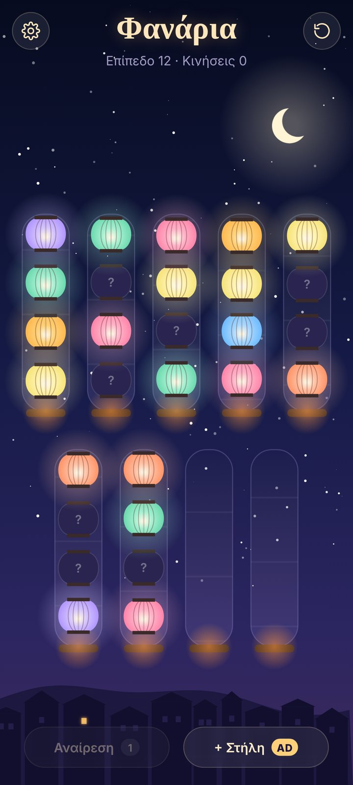
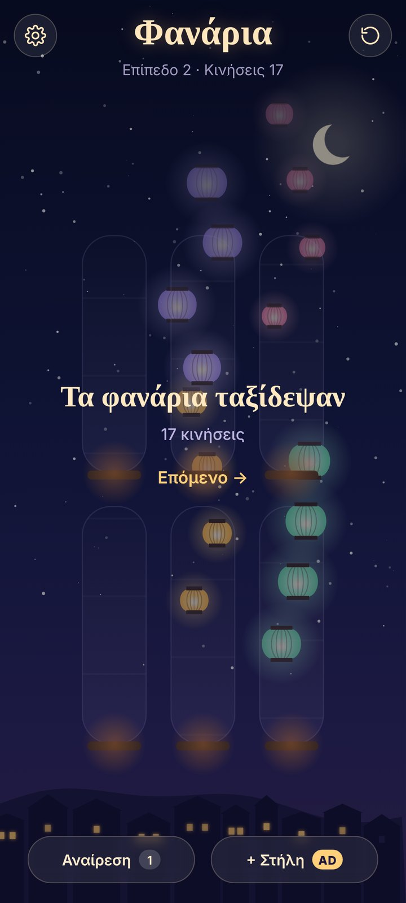
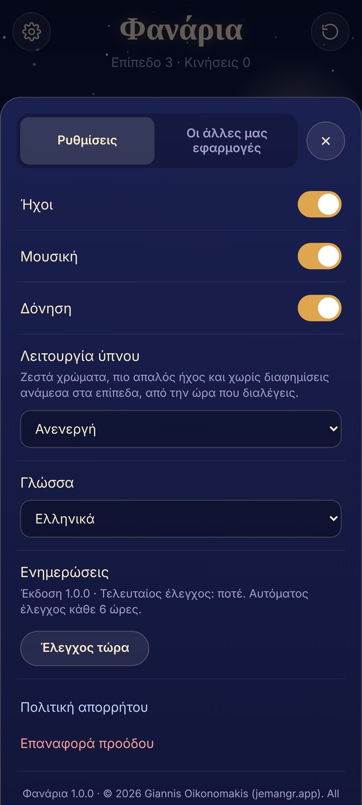
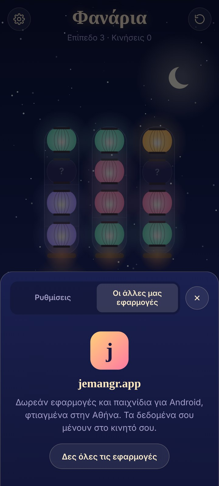
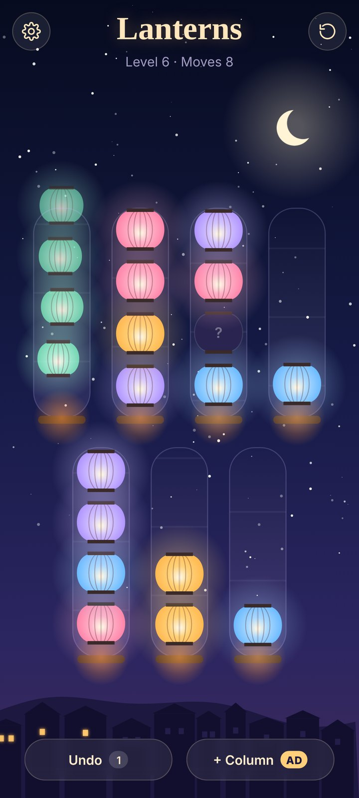

  

<h1 align="center">🏮 Φανάρια · Lanterns</h1>

  <b>Ένα ήρεμο αλλά δύσκολο puzzle για πριν τον ύπνο.</b> 
  A calm but challenging lantern-sort puzzle for bedtime.

  

Android 7 ή νεότερο · Ελληνικά & English · χωρίς λογαριασμό · <a href="https://github.com/jemangr/fanaria-releases/releases">όλες οι εκδόσεις / all versions</a>

  
  
  
  

## Στα ελληνικά

Χάρτινα φανάρια αιωρούνται σε στήλες ζεστού αέρα. Τα ταξινομείς ώστε κάθε στήλη να έχει ένα χρώμα, και τότε τα φανάρια πετούν στον νυχτερινό ουρανό και ανάβουν τα παράθυρα του χωριού από κάτω.

- **Ήρεμο αλλά δύσκολο:** χωρίς χρονόμετρο. Η δυσκολία έρχεται από τη σκέψη, με κρυφά φανάρια «?» που δείχνουν το χρώμα τους μόνο όταν βρεθούν στην κορυφή.
- **Κάθε επίπεδο λύνεται:** τα επίπεδα φτιάχνονται αυτόματα και ελέγχονται πριν τα δεις.
- **Λειτουργία ύπνου:** από την ώρα που διαλέγεις, ζεστότερα χρώματα, πιο απαλός ήχος και καθόλου διαφημίσεις ανάμεσα στα επίπεδα.
- **Απαλή μουσική και ήχοι**, δόνηση, Ελληνικά και English.
- **Ενημερώσεις:** η εφαρμογή ελέγχει μόνη της κάθε 6 ώρες για νέα έκδοση.
- **Δωρεάν**, με προαιρετικές διαφημίσεις για αναίρεση ή επιπλέον στήλη.

### Εγκατάσταση
1. Πάτα **Download APK** από το κινητό σου.
2. Άνοιξε το αρχείο και επίτρεψε μία φορά την εγκατάσταση από αυτή την πηγή.
3. Για ενημέρωση, κατέβασε το νέο APK και εγκατάστησέ το πάνω από το παλιό. Η πρόοδός σου μένει.

## In English

Paper lanterns float in columns of warm air. Sort them so each column holds one color, and they drift up into the night sky while the village below lights up.

- **Calm, not easy:** no timers. Hidden "?" lanterns show their color only when they reach the top.
- **Every level is solvable:** levels are generated and checked before you see them.
- **Sleep mode:** from the hour you choose, warmer colors, softer sound and no ads between levels.
- **Soft music and sounds**, vibration, Greek and English.
- **Updates:** the app checks for a new version every 6 hours.
- **Free**, with optional ads for an undo or an extra column.

  
  

## Περισσότερες εφαρμογές · More apps

Όλες οι εφαρμογές μου: **[jemangr.app](https://jemangr.app)**

---

© 2026 Giannis Oikonomakis ([jemangr.app](https://jemangr.app)). All Rights Reserved. See [LICENSE](LICENSE).
