

  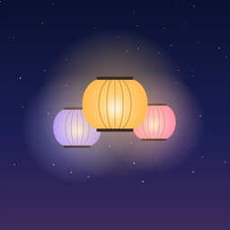

<h1 align="center">🏮 Φανάρια · Lanterns</h1>

  <b>Ένα ήρεμο αλλά δύσκολο puzzle για πριν τον ύπνο.</b> 
  A calm but challenging lantern-sort puzzle for bedtime.

  

Android 7 ή νεότερο · Ελληνικά & English · χωρίς λογαριασμό · <a href="https://github.com/jemangr/fanaria-releases/releases">όλες οι εκδόσεις / all versions</a>

  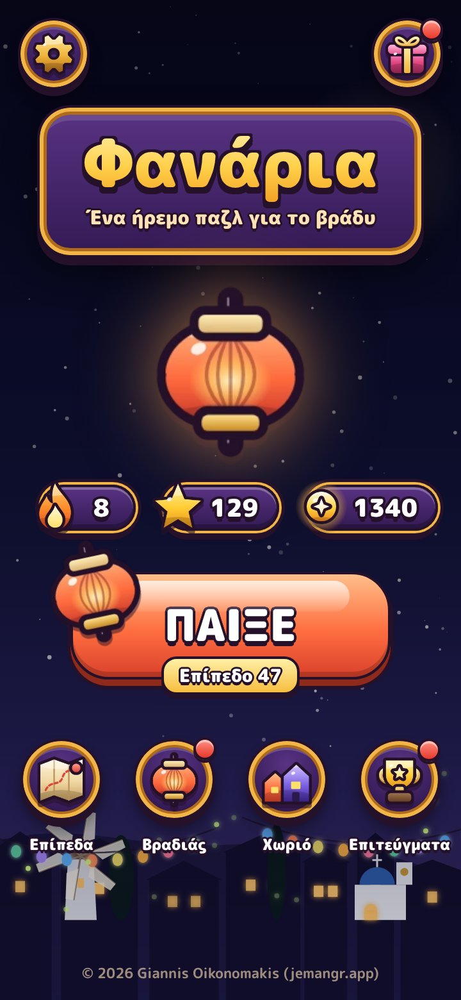
  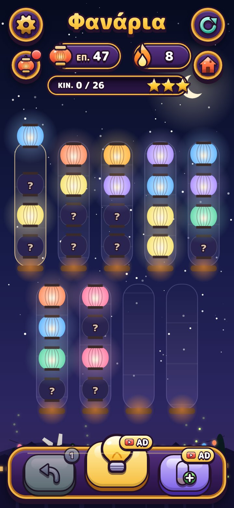
  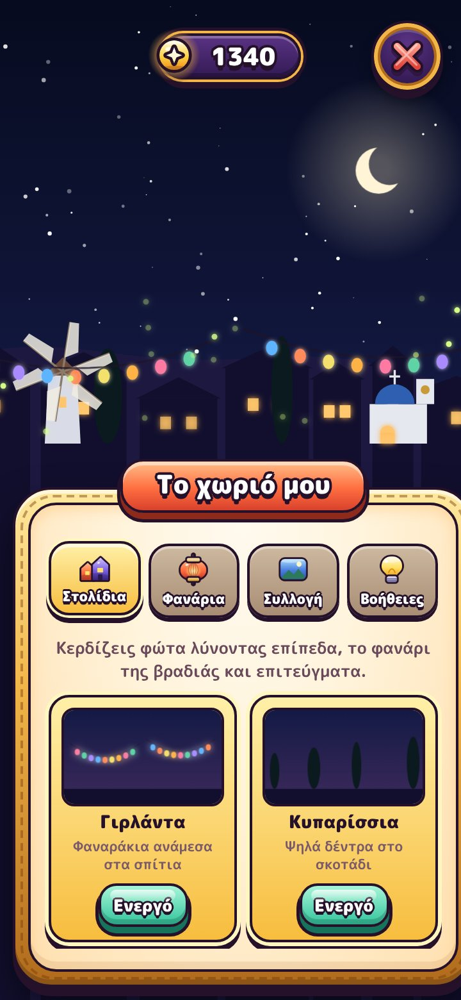
  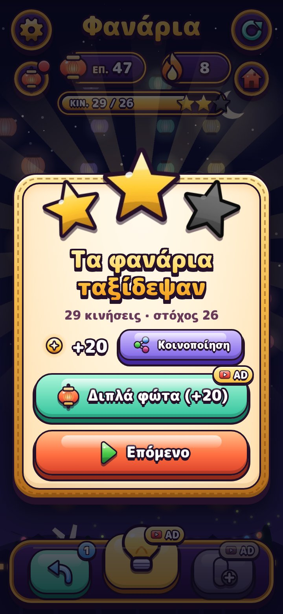

## Στα ελληνικά

Χάρτινα φανάρια αιωρούνται σε στήλες ζεστού αέρα. Τα ταξινομείς ώστε κάθε στήλη να έχει ένα χρώμα, και τότε τα φανάρια πετούν στον νυχτερινό ουρανό και ανάβουν τα παράθυρα του χωριού από κάτω.

- **Ήρεμο αλλά δύσκολο:** χωρίς χρονόμετρο. Κρυφά φανάρια «?», παγωμένες στήλες που λιώνουν όσο ολοκληρώνεις στήλες, και ψηλές στήλες των 5.
- **Κάθε επίπεδο λύνεται:** τα επίπεδα φτιάχνονται αυτόματα και ελέγχονται πριν τα δεις.
- **Αστέρια με δίκαιο στόχο** και **χάρτης επιπέδων** για να ξαναπαίξεις όποιο θέλεις για τα 3 αστέρια.
- **Φανάρι της βραδιάς:** ένα νέο παζλ κάθε βράδυ, ίδιο για όλους, με σερί 🔥, ημερολόγιο για τις βραδιές που έχασες και πάγωμα σερί.
- **Το χωριό σου:** κερδίζεις φώτα και το στολίζεις με γιρλάντες, ανεμόμυλο, ξωκλήσι, πυγολαμπίδες, ουράνια φανάρια. Διαλέγεις και σχήμα φαναριών.
- **7 τοπία:** χωριό, λίμνη, βουνά, θάλασσα, δάσος, χιονισμένο χωριό, νησί.
- **Επιτεύγματα** και **δώρο κάθε μέρα**.
- **Εποχιακά θέματα:** Χριστούγεννα, Απόκριες, Πάσχα, καλοκαίρι, Halloween.
- **Σύμβολα στα φανάρια** για αχρωματοψία.
- **Λειτουργία ύπνου**, απαλή μουσική και ήχοι της φύσης που αλλάζουν με το τοπίο. Προαιρετική βραδινή υπενθύμιση.
- **Ενημερώσεις:** η εφαρμογή ελέγχει μόνη της κάθε 6 ώρες για νέα έκδοση.
- **Δωρεάν**, με διαφημίσεις και προαιρετικές διαφημίσεις για βοήθεια.

  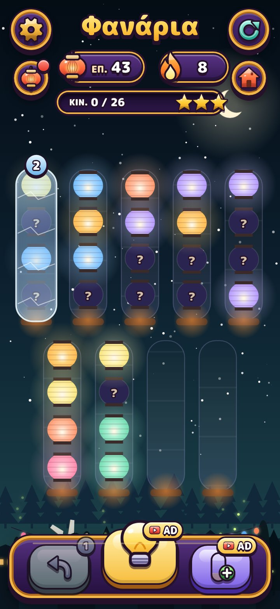
  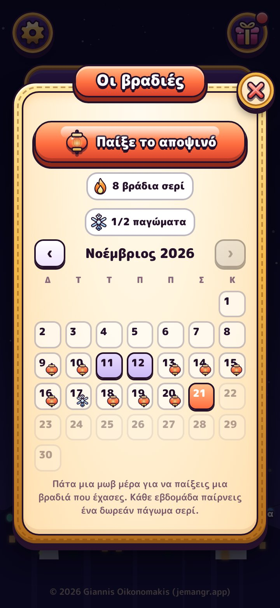
  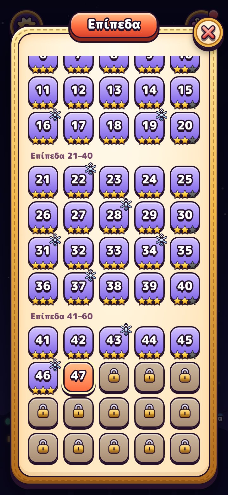
  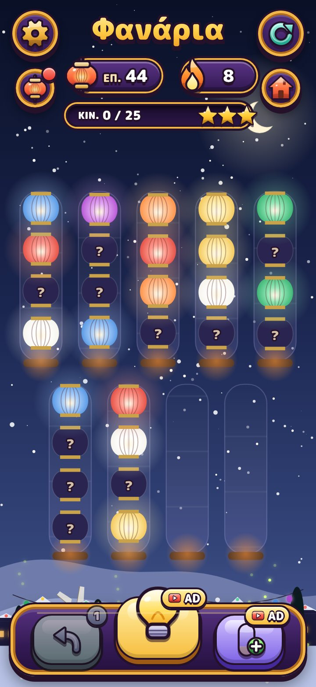

### Εγκατάσταση
1. Πάτα **Download APK** από το κινητό σου.
2. Άνοιξε το αρχείο και επίτρεψε μία φορά την εγκατάσταση από αυτή την πηγή.
3. Για ενημέρωση, κατέβασε το νέο APK και εγκατάστησέ το πάνω από το παλιό. Η πρόοδός σου μένει.

## In English

Paper lanterns float in columns of warm air. Sort them so each column holds one color, and they drift up into the night sky while the village below lights up.

- **Calm, not easy:** no timers. Hidden "?" lanterns, frozen tubes that thaw as you complete columns, and tall tubes of 5.
- **Every level is solvable:** levels are generated and checked before you see them.
- **Fair stars** and a **level map** to replay any level for 3 stars.
- **Tonight's lantern:** a new puzzle every night, the same for everyone, with a 🔥 streak, a calendar for missed nights and streak freezes.
- **Your village:** earn lights and decorate it with garlands, a windmill, a chapel, fireflies and sky lanterns. Pick a lantern style too.
- **7 landscapes:** village, lake, mountains, sea, forest, snowy village, island.
- **Trophies** and a **daily gift**.
- **Seasonal themes:** Christmas, Carnival, Easter, summer, Halloween.
- **Symbols on lanterns** for color blindness.
- **Sleep mode**, gentle music and nature sounds that change with the landscape. Optional evening reminder.
- **Updates:** the app checks for a new version every 6 hours.
- **Free**, with ads, plus optional ads for help.

  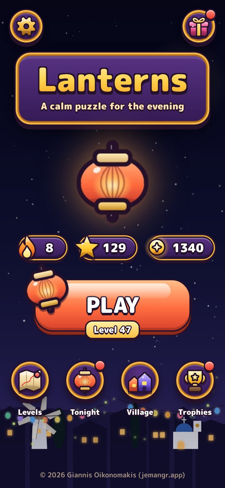
  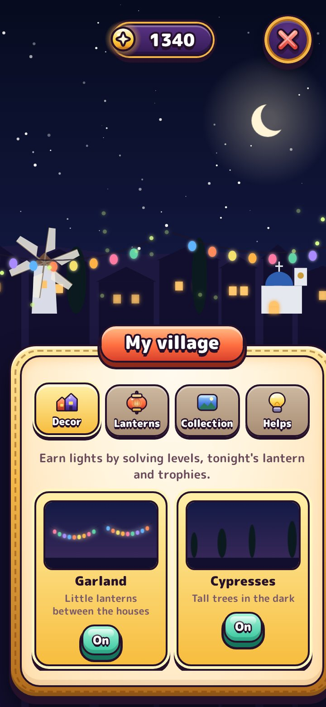
  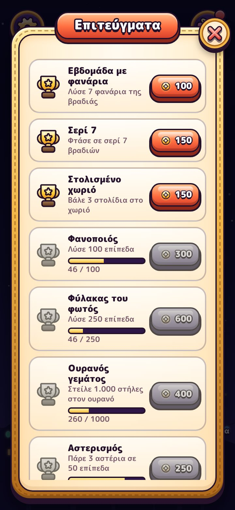
  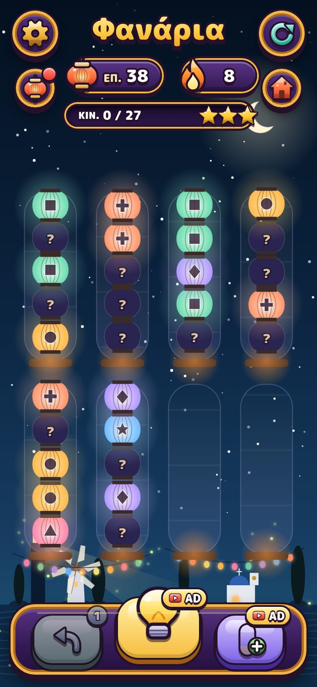

## Περισσότερες εφαρμογές · More apps

Όλες οι εφαρμογές μου: **[jemangr.app](https://jemangr.app)**

---

© 2026 Giannis Oikonomakis ([jemangr.app](https://jemangr.app)). All Rights Reserved. See [LICENSE](LICENSE).
